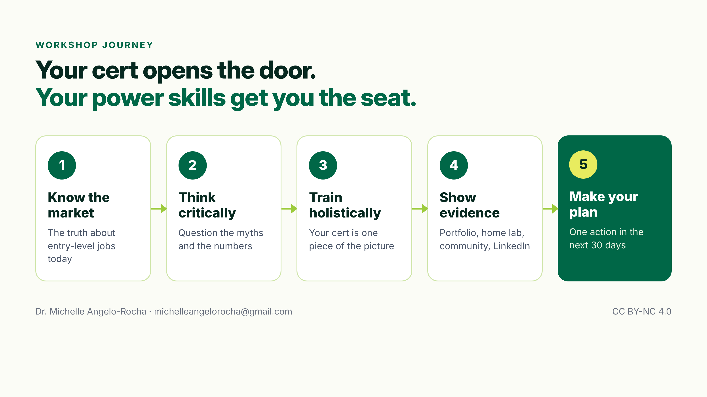

# Your Cert Opens the Door. Your Power Skills Get You the Seat.

Workshop by Dr. Michelle Angelo-Rocha, Cyber Research Analyst at Cyber Florida, University of South Florida.

Presented at the Florida College System Cybersecurity Competition, Tallahassee, October 19-20, 2026.

## About this workshop
This workshop helps cybersecurity students understand the entry-level job market and build the power skills employers are asking for. Students leave with a personal action plan.

## My Career Game Plan
A free worksheet for cybersecurity students and entry-level job seekers. It helps you look at the skills you already have, find what is missing, and make a simple action plan for your next 30 days.

How to use it:
1. Print it or fill it in on your computer.
2. Answer the questions honestly. It is not a test.
3. Choose one action and start this month.
4. After 30 days, look at it again and see how far you came.

I created this worksheet for my workshop, but anyone can use it.

## How I made this
I designed the content of this workshop from my research and my conversations with employers and students. I used Claude, an AI assistant, as a tool to help me build the slides, the worksheet, and this visual, and to practice my talk. The ideas and the decisions are mine. This is the same message I share with students: use AI to help you, not to think for you.

## License
These materials are licensed under CC BY-NC 4.0. You are free to share and adapt them with credit, but not for sale.

## Contact
E-mail: michelleangelorocha@gmail.com
LinkedIn: https://www.linkedin.com/in/michelleangelo-rocha/
